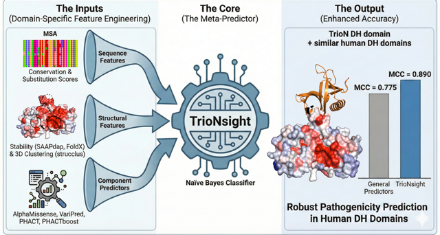

# TrioNsight

<h4 align="center">A specialised variant effect predictor for TrioN-like Dbl-homology domains</h4>

<p align="center">
    <a href="https://github.com/alptaciroglu/TrioNsight/commits/master">
    
    <a href="https://github.com/alptaciroglu/TrioNsight/issues">
    
</p>
      
<p align="center">
  <a href="#-installation">🔧 Installation</a>
  <a href="#-run-trionsight">🚀 Run TrioNsight</a>
  <a href="#-data-availability">✔ Data availability</a>
  <a href="#-citing-this-work">❛❛❞ Citing this work</a>
  <a href="#-acknowledgement">🤝 Acknowledgement</a>
</p>

---

<table>
<tr>
<td>

* **TrioNsight** is a variant effect predictor trained on TrioN-like DH domains - N-terminal Dbl-homology domain of TRIO (TrioN) and Dbl-homology domains that are highly similar to TrioN (13 Human DH domains in total).

* Data for all possible amino acid replacements are available - 50122 variant effect predictions from 13 TrioN-like DH domains (2638 residues in total).

* Installing and running TrioNsight is <ins>not required</ins> to obtain the data for all possible amino acid replacements. It can be found in "TrioNsight_predictions.txt" file located under the main branch.

* To reproduce the results, please continue with installing and running TrioNsight.


<p align="right">
<sub>(Preview)</sub>
</p>

</td>
</tr>
</table>

## 🔧 Installation 

### <ins>Base</ins>

```
git clone git@github.com:alptaciroglu/TrioNsight.git
cd TrioNsight

conda env create -f environment.yml
conda activate trionsight
```

### <ins>VariPred</ins>

For the VariPred repo please visit https://github.com/wlin16/VariPred

> [!NOTE]  
> Not mandatory if you'd like to use precalculated VariPred output used in the training of the TrioNsight -> Go to [SAAPdap](#saapdap)
>
> If you need to run VariPred yourself, continue with VariPred installation directly below

```
git clone https://github.com/wlin16/VariPred.git
cd VariPred
pip install -r requirements.txt
pip install torch==2.0.0 torchvision==0.15.1 torchaudio==2.0.1 --index-url https://download.pytorch.org/whl/cu118
pip install fair-esm

cd ../
cp -f VariPred_files/predict.sh VariPred/VariPred/predict.sh
# File contains adjusted paths only
cp -f VariPred_files/main.py VariPred/VariPred/main.py
# File contains adjusted paths only
```

### <ins>SAAPdap</ins>

For the SAAPdap repo please visit https://github.com/ACRMGroup/SAAP3

> [!NOTE]  
> Not mandatory if you'd like to use precalculated SAAPdap output used in the training of the TrioNsight -> Go to [Run TrioNsight](#-run-trionsight)
> If you need to run SAAPdap yourself, continue with SAAPdap installation directly below

Please go to SAAP3 repository and follow the installation instructions.
SAAPdap should be installed under TrioNsight/structure_analysis/. Alternatively, modify the paths under TrioNsight/scripts/SAAPdap.R wrapper function based on chosen SAAPdap installation directory.

### <ins>R packages</ins>

```
# Under preferred IDE for R
source('scripts/helper.R')
```

## 🚀 Run TrioNsight

> [!IMPORTANT]
> Running TrioNsight is not required to access the data for all possible amino acid replacements - 50122 variant effect predictions.
> To access this data, please download "TrioNsight_predictions.txt" file located under the main branch.
> To reproduce the results, please continue with running TrioNsight.

```
# Under preferred IDE for R
source('scripts/TrioNsight.R')
```

## ✔ Data availability

## ❛❛❞ Citing this work

## 🤝 Acknowledgement

We gratefully acknowledge the fundings from the following organisations:

Alperen Taciroğlu was supported by: 
* 2211/A National PhD Scholarship Programs from Scientific and Technological Research Council of Türkiye (TÜBİTAK).
* Scientific Exchange Grant (Case: 9964) from European Molecular Biology Organization (EMBO).
This work was supported by funding from Council of Higher Education Turkey (YÖK) - Research Universities Support Program (project no: ADEP-704-2024-11501).

We gratefully acknowledge the help from the following researchers:

* Dr. Nicola Bordin for his help in obtaining FunFams assignments of Dbl-like homology domains in the CATH-Gene3D resource base, and for developing the scorecons.py function to run ScoreCons without alignment size limitation.
* Dr. Ian Sillitoe for his assistance in modeling Dbl-like homology domains together with Pleckstrin homology domains using AlphaFold2.
* Dr. Paul Ashford for his valuable discussions on the 3D-clustering of variants on protein structures.
* Dr. Vaishali Waman for her help in generating high-resolution structural models using PyMOL.
* Weining Lin for her insightful discussions on state-of-the-art variant impact predictors.
* PI Ogün Adebali for allowing access to Sabancı University Troya HPC Cluster. 
